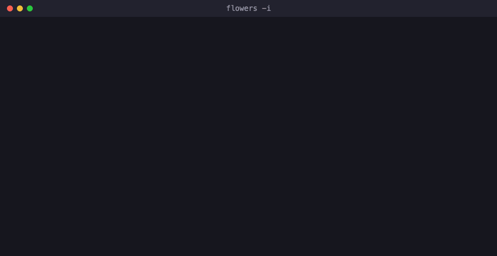
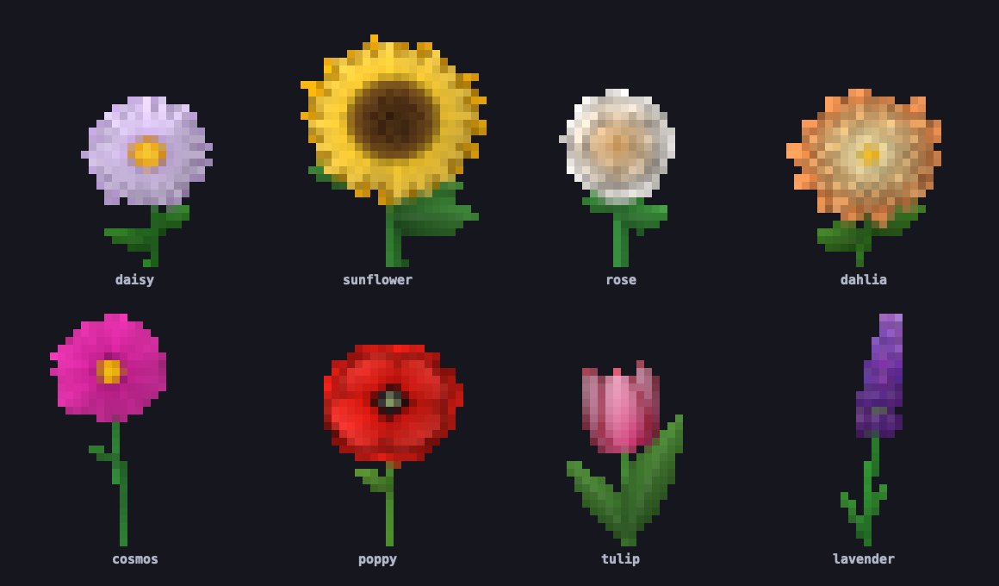

<h1 align="center">🌷 flowers 🌻</h1>

<p align="center"><strong>Your terminal deserves a garden.</strong></p>

<p align="center">
  
</p>

Your terminal spends all day showing you logs, diffs and stack traces. Give it a break. 🌼

`flowers` grows a whole garden of colorful flowers right in your terminal: sunflowers with
spiral seed heads, roses furled tight at the heart, poppies with dramatic dark eyes, spikes of
lavender and more. Every flower is drawn fresh from math each time you run it, with its own
palette and its own little quirks, so you'll never grow the same garden twice. Unless you
want to! Every garden comes with a seed, and handing it back regrows it exactly.

Fire it off for a quick splash of color, sit back and watch a garden sprout and bloom, or dive
into interactive mode and grow garden after garden from your keyboard.

## ✨ What's growing

- 🌻 **Eight species**, from towering sunflowers to tiny lavender florets, each with several palettes and petal-by-petal variation.
- 🎨 **Silky-smooth art**: anti-aliased shapes in full 24-bit color, two square pixels packed into every character cell.
- 🌱 **Watch it grow**: stems shoot up, leaves unfurl, and flowers pop open one after another.
- 🎮 **Interactive mode**: grow new gardens, flip back to old favorites, and switch species, flower count and grass on the fly.
- 🔁 **Regrow your favorites**: every run prints its seed, and the same seed, size and options always grow the same garden.
- 🔌 **Pipe-friendly**: the art goes to stdout and the seed to stderr, so the picture comes out clean wherever you send it.

## 🚀 Get growing

You'll need Rust 1.85 or newer (grab it from [rustup.rs](https://rustup.rs)). Then, from a
checkout of this repository:

```sh
cargo install --path .
```

That's it: `flowers` is on your `PATH`! Want a test drive first? Swap in
`cargo run --release --` for `flowers` in any of the examples below.

## 🌼 Quick start

```sh
flowers                  # a garden sized to fit your terminal
flowers -n 1             # one big, show-stopping flower
flowers --bloom          # watch it sprout and bloom
flowers -k rose,tulip    # a bouquet of just roses and tulips
flowers -s 7             # regrow a garden from its seed
flowers -i               # the full interactive experience
```

💡 **Pro tip:** add `flowers -n 1 -H 12` to your shell's startup file, and every new terminal
greets you with a fresh flower.

## 🎮 Interactive mode

`flowers -i` takes over the whole terminal and turns it into a garden you can play with.
Resize the window and the garden regrows to fit. The bar along the bottom shows which species
are in bloom, the current seed, and every key you need. When you quit, it hands you the seed
of the garden on screen, so the one you fell for is never lost.

| Key | What happens |
| --- | --- |
| `space` / `enter` / `n` | Grow a brand-new garden |
| `←` / `→` | Flip back and forward through gardens you've seen |
| `b` | Watch the bloom again |
| `1`–`8` | Toggle a species on or off (at least one always stays) |
| `0` | Bring every species back |
| `+` / `-` (or `↑` / `↓`) | More flowers, or fewer |
| `g` | Grass on or off |
| `q` / `esc` / `ctrl-c` | Say goodbye |

Want to start somewhere specific? `--kind`, `--count`, `--seed`, `--no-grass` and `--colors`
all set where the session begins.

## 💐 Meet the flowers

<p align="center">
  
</p>

| Species | What makes it special |
| --- | --- |
| `daisy` | Cheerful white, blush or lilac rays around a golden eye |
| `sunflower` | Big golden heads with hypnotic spiral seed centers |
| `rose` | Layer upon layer of petals furled around a swirling heart |
| `dahlia` | Ring after ring of pointed petals that glow toward the middle |
| `cosmos` | Eight notched petals bobbing on a slender stem |
| `poppy` | Silky cups with a dramatic dark eye |
| `tulip` | Elegant side-on cups, some with flames licking the rim |
| `lavender` | Purple spikes packed with tiny florets |

## 🎛️ Options

| Flag | What it does |
| --- | --- |
| `-n, --count <N>` | Number of flowers (default: as many as fit the width) |
| `-k, --kind <KINDS>` | Only grow these species, comma-separated or repeated |
| `-s, --seed <SEED>` | Seed for a reproducible garden |
| `-W, --width <COLS>` | Width in columns (default: terminal width) |
| `-H, --height <ROWS>` | Height in rows (default: 24, or less to fit) |
| `-b, --bloom` | Animate the garden growing |
| `-i, --interactive` | Browse gardens full-screen with the keyboard |
| `--no-grass` | Leave out the grass |
| `--colors ansi256` | For terminals without 24-bit color |

## 🖥️ Terminal support

`flowers` paints in full 24-bit color, which most modern terminals speak fluently. If your
colors look off or stripy (older versions of macOS Terminal, we're looking at you), add
`--colors ansi256` and it'll stick to the classic 256-color palette.

## 🔬 How it works

No pixel art was harmed in the making of this garden, because there isn't any. Every flower
is built from math: petals are curves repeated around a center, and each ring of petals casts
a soft shadow on the ring beneath it. Sunflower and daisy centers pack their seeds in the same
golden-angle spiral that real sunflowers use, and stems are gently curving Bézier paths.

The garden is painted onto a canvas that samples every pixel nine times for buttery-smooth
edges, then printed with the half-block character `▀`. Its foreground color is the top pixel
and its background the bottom one, so every character cell shows two square pixels. A tiny
random number generator, fed by the seed, makes every choice along the way. That's why the
same seed, size and options always regrow the same garden.

🏖️ **Fun fact:** `--seed` takes any whole number up to 18,446,744,073,709,551,615. That's
more than twice the estimated number of grains of sand on Earth.

## 🛠️ Development

```sh
cargo test
cargo clippy --all-targets -- -D warnings
```

Happy hacking, and happy gardening! 🌱
